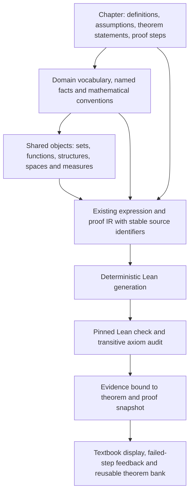

# Plan: reusable mathematical foundations and textbook authoring

Review date: 2026-11-17. This is a proposed implementation sequence, not a claim that
the proposed APIs or domain coverage already exist. Local checks are recorded in
[the roadmap](roadmap.md#foundation-review-2026-11-17).

## Recommendation

Build a common mathematical vocabulary and a chapter authoring layer on the existing
verification engine. Prove that these work through small, reusable textbook chapters
before expanding to more subjects. Keep Lean and Mathlib as the formal foundation;
PyLeanX should supply the mathematical interface, conventions, explanations and reuse.

The product goal is: an author states the objects and assumptions, writes intermediate
mathematical claims, cites named results, and receives feedback at the failed step.
They should not need to discover Lean declaration paths, supply instance arguments, or
choose tactics for ordinary steps in a supported chapter. Arbitrary research mathematics
will still require new vocabulary and formal proofs from library contributors.

Use structured mathematical authoring first. A free-form English or LaTeX input layer
can later propose structured statements for review. Neither English fluency nor a
successful proof establishes that a translation expresses the author's intended theorem.

## What the repository already provides

| Existing component | Evidence in source | Build on it |
|---|---|---|
| Expression, binder and proof IR; deterministic Lean generation | `expr.py`, `types.py`, `binders.py`, `render/lean.py` | Preserve the translation and source maps |
| Pinned batch verification, diagnostics, transitive axiom audit and caching | `backend/subprocess_backend.py`, `backend/audit.py`, `project.py` | Keep this as the final verification gate |
| Written proof steps | `proofs.py`: `claim`, `chain`, `fix`, `choose`, `take`, `cases_on`, `induction_on`, `conclude` | Make these the primary authoring vocabulary |
| Mathematical display and step explanations | `prose.py`, `render/latex.py`, `explain.py` | Render the same formal objects the checker consumes |
| Definitions, structures and abstract parameters | `defs.py`, `types.py`: `type_param` | Support user-defined concepts and shared settings |
| Citable theorem objects and persisted evidence | `proofs.py`: `TheoremRef`, `bank.py`, `serialize.py` | Reuse proof-carrying results across chapters |
| Domain vocabulary and proved bridge facts | `algebra.py`, `numbers.py`, `analysis.py`, `geometry.py`, `complex_analysis.py`, `harmonic.py`, `realvar.py` | Consolidate and extend; do not replace working examples |
| Declaration metadata and statement comparison | `bindings.py`, `faithful.py` | Seed curated bindings and check exact statements |

The existing `readable_limit_sum.py` and `readable_group_abelian.py` examples already
express recognisable mathematical arguments. The project is beyond a basic subprocess
wrapper. However, examples and theorem-name catalogs do not yet establish comprehensive,
consistent support for a domain.

## Gaps that determine the architecture

1. **Shared objects and conventions are fragmented.** For example, `realvar.set_of` and
   `finset_of` construct types through a small Nat/Real/Int lookup; interval and set
   helpers occur in several domain modules. General functions and products exist, but
   general sets, maps between spaces, measures and subspaces need a coherent public
   interface that domains can share.
2. **Curated facts need richer contracts.** `_domain.lemma` currently returns a `Name`
   with imports and a display label. Chapter authors also need the exact statement,
   required assumptions, argument roles, conventions, aliases and coverage status.
   Existing declaration export and statement comparison can supply part of this.
3. **Routine proof automation is growing centrally.** `Justify._core` contains general
   strategies alongside geometry-specific conversions and side-condition handling.
   Separate reusable strategies and domain rules, with deterministic budgets and
   understandable failures, before adding many more special cases.
4. **A textbook is more than a theorem list.** Reusable chapter settings, numbered
   definitions/results, references, draft status and document export need an explicit
   document model. Theorem objects and the bank already provide much of the reuse layer.
5. **Proof validity and readable evidence must stay connected.** In the reviewed code,
   `prose(thm, result)` uses a supplied result's `verified` field without checking that
   the result belongs to the current theorem/proof. Add binding of displayed evidence
   to an exact immutable verification snapshot. This is a presentation risk; this
   review does not establish a bypass of the batch verifier.
6. **Release evidence needs reconciliation.** The roadmap contains historical blockers
   and superseded feature descriptions. M0–M4 have local implementation evidence, but
   fresh-install/Linux CI acceptance remains recorded as unfinished. Close those gates
   before treating broader domain coverage as a stable foundation.

## Architecture to converge on

Do not build a second mathematical foundation or a dependent-type checker in Python.
Shared descriptors record syntax, roles, scopes and conventions. Lean remains
responsible for elaboration, implicit arguments, instance synthesis and proof checking.

### Shared mathematical objects

Extend the current descriptors with compositional constructors for sets and finite sets
of arbitrary supported element types, maps, indexed families and subspaces. Reuse
`Fn`, `Prod`, `Fin`, lambdas and big operators where possible. Add generic membership,
subset, image, preimage, union/intersection and extensional equality operations.

Next support explicit mathematical settings: a scalar field, vector space over that
field, normed/inner-product space, topological space, measurable space and measure.
Start with tested concrete specialisations; introduce generic dependent settings only
as the chapters require them. Preserve the underlying field and ambient space in the
descriptor so a mathematical display cannot quietly erase them.

Conventions must be visible in statements and documentation: real versus complex
scalars, pointwise versus almost-everywhere equality, functions versus Lp equivalence
classes, probability measure versus arbitrary measure, finite versus infinite sums,
totalised division, and Mathlib's definitions of derivatives, logarithms and square roots.
Do not silently add regularity or nonzero assumptions to make a proof succeed.

### A contract for every domain pack

A domain pack should contain:

- Definitions and objects with stable PyLeanX identifiers and mathematical notation.
- Curated facts with argument roles, exact formal statements, assumptions, import
  closure, Lean declaration or shipped proof, and toolchain/Mathlib pins.
- Proven bridges between textbook definitions and reusable Mathlib abstractions.
- Scoped simplification/application rules, with deterministic order and resource budgets.
- Runnable textbook chapters, reuse examples and deliberately invalid variants.
- A coverage manifest distinguishing supported, experimental and unavailable concepts.

For example, a named Cauchy–Schwarz fact must identify its scalar field, inner-product
space and norm conventions; a search result should show those assumptions before it
can be cited. A missing hypothesis becomes an explicit obligation. An exported Lean
name existing is only a name check, not certification that a wrapper states the intended
mathematical fact.

Use statement comparison by definitional equality where appropriate. Where a textbook
form is only logically equivalent to Mathlib's form, ship and check an equivalence or
adapter theorem; do not weaken `same_statement_as` to accept arbitrary similarity.

### Textbook authoring

First wrap existing theorem/definition objects in a small document model with sections,
scoped assumptions, labels, references and a dependency graph. Materialise section
assumptions into every exported theorem; leaving a section must not leave hidden mutable
context. Draft results can appear in a document, but cannot serve as proved citations.

Keep the existing `pl.proof`, `pl.claim`, `pl.chain`, `pl.choose` and `pl.conclude` API.
An initial chapter should read as: define a sequence; state its assumptions; choose an
index from convergence; bound two errors; conclude by the triangle inequality. The
author should cite a mathematical fact or an earlier result, not a Lean path.

Output numbered definitions, lemmas, theorems and proofs to notebooks and HTML first;
add Markdown/LaTeX export after the document model stabilises. Show the exact statement,
all assumptions, proof obligations and evidence. Explanatory notes remain comments and
must not receive an independent verification badge.

### Mathematical feedback and automation

Separate the current gap filler into core arithmetic/logical strategies and domain
strategies. Each step has a goal, available hypotheses, cited facts, local definitions
and a budget. Report failure as, for example, "Step 4 needs x ≠ 0 to divide by x" when
that obligation comes from Lean; otherwise say the step was not proved and show the
remaining obligation. Do not infer mathematical falsity from automation failure.

Distinguish search hints from enforced dependencies. Today `because=` supplies useful
facts, and earlier claims/global automation may also finish the step. Keep that default
clear. A later teaching mode may restrict available facts, but must specify and audit
its dependency boundary. `avoid=` is useful for selected exclusions; it is not a
universal guarantee of pedagogical independence.

## Domain order and concrete acceptance chapters

Rows describe proposed coverage, not current completeness. A pack is ready only for
the documented scope that passes its chapter tests.

| Order | Domain | Foundational vocabulary | Acceptance chapter |
|---|---|---|---|
| 1 | Logic, sets and maps | Quantifiers, membership, subsets, images, injective/surjective maps, finite sums | Image/preimage laws and composition of injections, with reusable intermediate lemmas |
| 2 | Algebra and elementary number theory | Existing numeric sorts and group/ring/field support; homomorphisms, divisibility, induction | Group cancellation; an elementary divisibility argument; a polynomial identity reused in an inequality |
| 3 | Linear algebra | Vector spaces over an explicit field, linear maps, spans, bases, matrices, inner products | Cauchy–Schwarz implies the triangle inequality; then an orthogonal-projection estimate |
| 4 | Real analysis and topology | Sequences, limits, continuity, compactness, differentiability, integration | Limit of a sum from ε–N; mean-value reasoning and a reusable Lipschitz bound |
| 5 | Measure and probability | Sigma algebras, measures, integrability, a.e. predicates, random variables, expectation | Linearity of expectation and a Markov bound with all integrability/nonnegativity conditions |
| 6 | Euclidean geometry | Existing points, lines, segments, angles and triangles; explicit nondegeneracy | Similarity, side splitter and Pythagoras, then a new theorem citing the chapter's objects |
| 7 | Complex and harmonic analysis | Holomorphic functions, contours, Fourier conventions, Lp spaces | Reuse Cauchy's formula; reuse a proved Fourier/L2 result with explicit normalisation |
| 8 | Differential equations and scientific estimates | Time-dependent functions, derivatives, norms, initial/boundary data, regularity | A scalar ODE energy estimate; a conditional stability bound with hypotheses exposed |

Geometry already has substantial examples and can validate the pack contract alongside
algebra; it need not wait for the analysis sequence. Probability depends on measure
theory; scientific estimates depend on linear algebra and analysis. Statistical inference,
manifolds, abstract algebra beyond the initial scope and PDE solution theories follow
only when their prerequisites and pinned-library coverage are established.

Units/dimensions and numerical error are separate scientific layers. Exact real algebra
does not certify floating-point code or experimental models. If added, model quantities,
unit conversions and approximation bounds explicitly, with their own acceptance tests.

## Implementation sequence and gates

These are proposed work packages after the current milestones, not retroactive changes
to what M0–M8 mean. Each package should be delivered in scoped, reviewable commits;
preserve existing notebooks and in-progress geometry work.

| Package | Main work and likely touchpoints | Completion gate |
|---|---|---|
| F0: reconcile and protect the baseline | `docs/roadmap.md`, release workflow, `prose.py`, evidence/result interfaces | Confirm outstanding M0–M4/release checks; a stale or unrelated result cannot label another proof checked; actual Lean positives and audit negatives pass |
| F1: common sets and maps | `types.py`, `terms.py`, binders, rendering, serialization; shared vocabulary module | Generic set/map chapter, canonical round trip and deterministic Lean; wrong element types and scope escape rejected by Python or Lean |
| F2: domain fact contracts | `_domain.py`, `bindings.py`, `faithful.py`, bank metadata | Pilot algebra/analysis facts have exact statements and assumptions; changed pins invalidate metadata; wrong wrappers fail contract tests |
| F3: reliable mathematical steps | Split `Justify` strategies; `explain.py`, source maps, domain rule registration | Existing readable examples retain behaviour; failures identify the mathematical step; measured cold/warm time and bounded search; false claims remain unverified |
| F4: chapter authoring | New document model over `Theorem`/definitions/citations, prose/notebook views | Two sections share definitions; one theorem reuses another; assumptions do not leak; cycles/unproved citations fail; changed proofs invalidate displayed evidence |
| F5: first complete packs | Logic/sets, algebra, linear algebra; use existing analysis/geometry as regression pilots | Each pack meets the contract, has multiple chained results and can be extended without editing the renderer or central gap filler |
| F6: expand by prerequisites | Analysis, measure/probability, geometry, complex/harmonic analysis, scientific estimates | Each addition passes chapter, semantic-edge and reuse tests before being advertised |

F1 and F2 set the common contracts; migrate representative existing helpers behind
compatible aliases rather than rewrite every domain at once. F3 can then use those
contracts, and F4 can compose them. Introduce a versioned structured Lean metadata/audit
helper only when needed, tested against the current pins. Interactive sessions can
accelerate feedback; final verification always uses the audited batch path.

### First three implementation PRs

1. **Evidence and baseline:** bind prose/display status to a theorem/proof snapshot;
   retain tests for unrelated results and mutation after verification; reconcile local
   baseline evidence and outstanding CI gates. Do not claim remote CI passed without
   its result.
2. **Sets/maps foundation:** compose `Set(T)`/finite-set descriptors for supported types;
   centralise membership, subset and image/preimage; add one short chapter and an
   invalid-type counterpart. Preserve old domain helper calls through compatibility.
3. **Curated fact pilot:** enrich a small selection of algebra and analysis facts with
   mathematical names, exact statement contracts and explicit assumptions; demonstrate
   lookup, citation and reuse in a new result without raw Lean or tactic selection.

Do not start by generating thousands of bindings or adding a natural-language parser.
Those do not resolve conventions, assumptions, usability or statement fidelity.

## How to measure success

- **Author experience:** in an initial evaluation with three mathematicians/scientists
  who do not use Lean, each extends a supported chapter with a new theorem and cites
  a previous result. Record tasks completed, time, interventions and needed Lean concepts.
- **Formal evidence:** every advertised example has a real pinned Lean check, clean
  transitive axiom audit and reproducible source/evidence. Negative variants include
  missing hypotheses, false conclusions, unproved citations and disallowed axioms.
- **Semantic fidelity:** manually review displayed statements and conventions; test
  important edge cases such as zero denominators, degenerate geometry and a.e. equality.
  Audit acceptance cannot replace this review.
- **Extensibility:** a contributor adds one concept, its bridge facts and a chapter
  without modifying the Lean renderer or a central tactic list.
- **Performance:** publish cold import, warm step and final batch timings separately;
  do not set a speedup claim from one cached run.

For each pack, keep pure construction/serialization tests, real Lean statement-contract
tests, complete chapter checks and cross-pack citation checks. Name existence alone
and successful prose rendering do not satisfy a domain acceptance gate.

## Upstream basis and compatibility boundary

Lean's [proof validation documentation](https://lean-lang.org/doc/reference/latest/ValidatingProofs/)
explains the distinction between accepting a proof and auditing its trust dependencies.
[Mathematics in Lean: sets and functions](https://leanprover-community.github.io/mathematics_in_lean/C04_Sets_and_Functions.html)
illustrates the typed sets/maps vocabulary a shared interface needs. These are design
references; their current versions are not compatibility guarantees for this checkout.
Resolve actual declarations and prove all wrappers against the project's pinned Lean
`v4.34.1` and Mathlib `d13f23b723b8a846827a245b89c10fc7d3f11612`.
